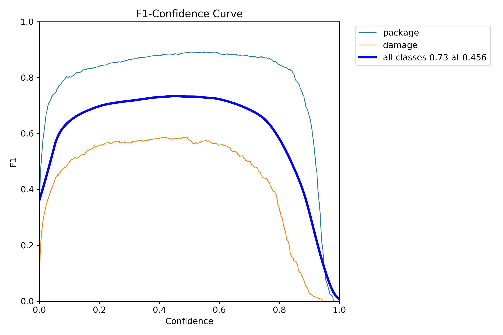
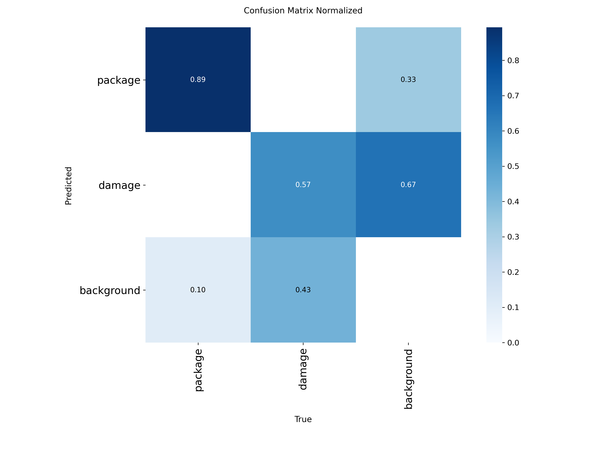
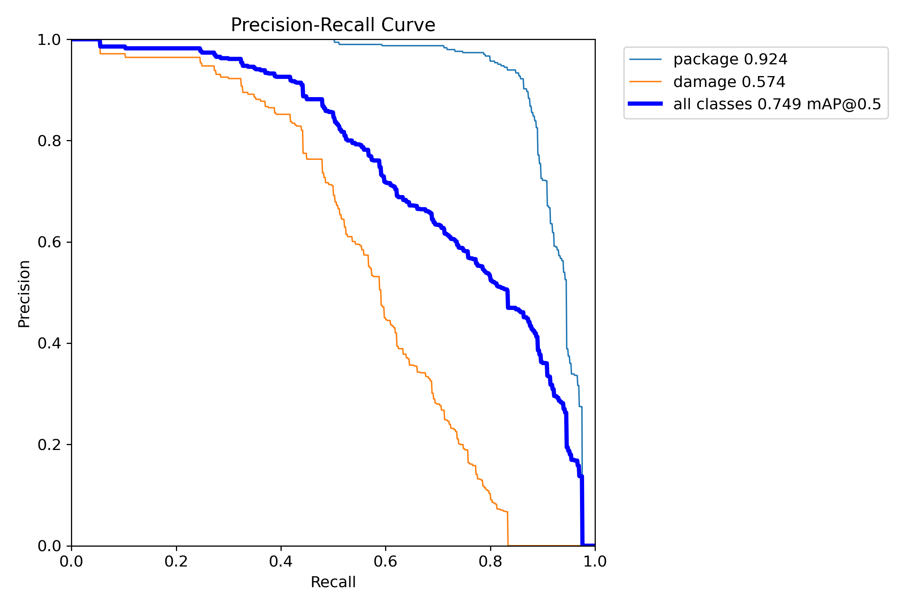
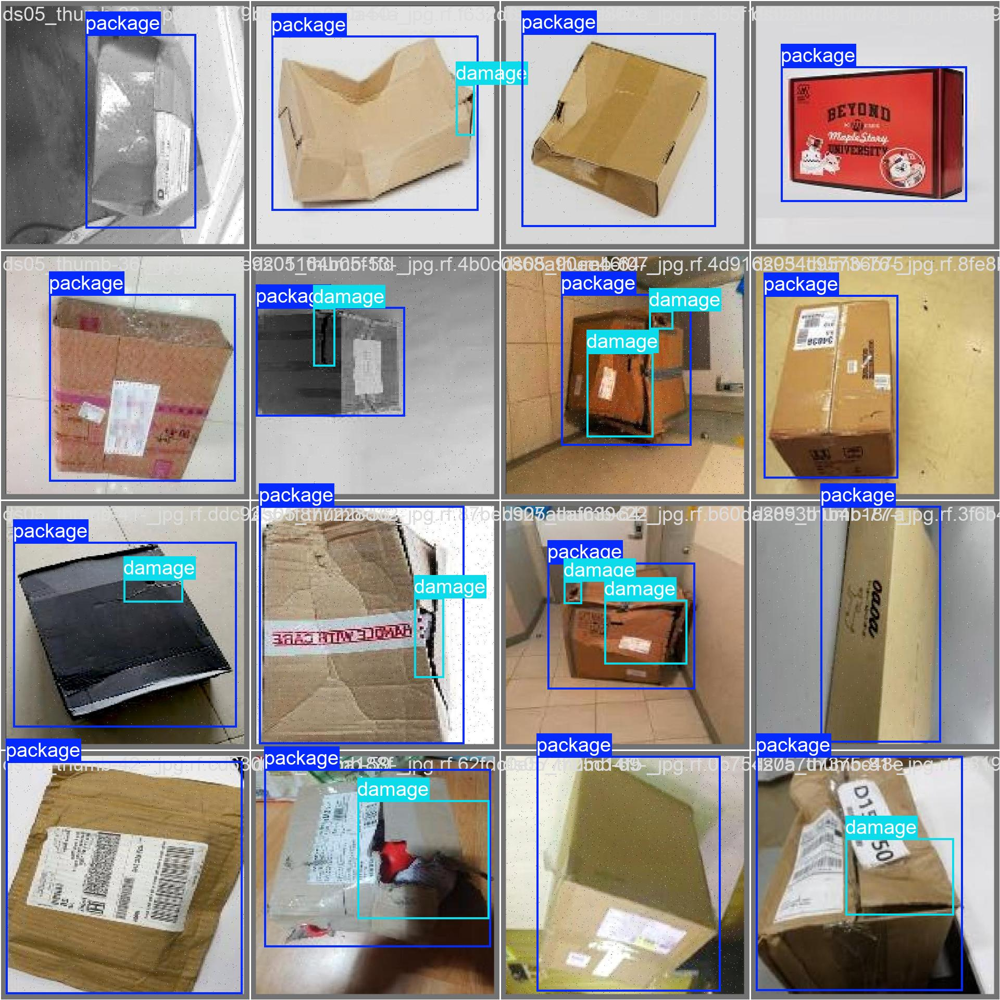

# Packaging Inspection and Shipment Readiness Assessment System

End-semester project for the **Deep Learning Lab** (MSc Big Data Analytics) by Nandhana V.

A photo of a package goes in. A clear verdict comes out, with a reason:
**Ready for Shipment**, **Repackage Required**, or **Manual Inspection**.

## How it works

```
photo -> YOLOv8s detector -> barcode check -> rules -> verdict
```

1. **Detector:** YOLOv8s (fine-tuned from COCO weights) finds two classes: `package` and `damage`.
2. **Barcode check:** OpenCV, pyzbar and zxing-cpp report the barcode as `readable`, `detected_unreadable` or `not_found`. It only adds a note; it does not change the verdict.
3. **Rules** (in `readiness_engine.py`):
   - package confidence below 0.25: Manual Inspection
   - damage confidence 0.05 or more: Repackage Required
   - package confidence below 0.60: Manual Inspection (photo unclear)
   - otherwise: Ready for Shipment

The damage cut-off is deliberately low so that possibly damaged packages are stopped. It was chosen on one half of unseen Kaggle images and measured on the other half.

## Dataset

Training data: 8 public Roboflow Universe datasets (3,171 images), merged into two classes, cleaned (rotated boxes converted to rectangles, near-duplicates removed) and split about 80/10/10. About 2,350 images remained. `merge_datasets.py` shows the steps. The data itself is not included; please get it from the original authors.

External check (never used in training):
- [Damaged and Intact Packages](https://www.kaggle.com/datasets/rahulm7323/damaged-and-intact-packages) (628 images)
- [Industrial Quality Control of Packages](https://www.kaggle.com/datasets/christianvorhemus/industrial-quality-control-of-packages) (400 images)

## Results

Detector on the test split (236 images):

| Class | Precision | Recall | mAP50 | mAP50-95 |
|---|---|---|---|---|
| All | 0.818 | 0.675 | 0.749 | 0.516 |
| Package | 0.902 | 0.868 | 0.924 | 0.750 |
| Damage | 0.734 | 0.482 | 0.574 | 0.282 |

Four models were compared on the same test split (single runs each): YOLO11s v1, v2 and v3, and YOLOv8s. YOLOv8s scored best (the gain over the baseline is about 2 points, so treat it as modest).

Whole system on unseen Kaggle photos (held-out half, damage cut-off 0.05): 60.2% of damaged packages stopped, 39.8% missed, 17.8% of intact packages wrongly sent to Repackage, 22.9% of intact packages sent to Manual Inspection.

Speed on an Intel i3 laptop (CPU only): about 0.31 s per image for the detector and about 1.1 s for the full pipeline.






## Run it

```
pip install -r requirements.txt
streamlit run app.py
```

`pyzbar` needs the ZBar library. On Windows it is bundled with the package. On Linux run `sudo apt install libzbar0`.

Use the engine directly:

```python
from readiness_engine import assess_package
result = assess_package("photo.jpg", model_path="best_yolov8s.pt")
print(result["verdict"], result["reason"])
```

## Reproduce

| Step | File |
|---|---|
| Merge and clean the datasets | `merge_datasets.py` |
| Train the model | `train_yolov8s.py` |
| Whole-system evaluation on Kaggle images | `verdict_metrics.py`, then `sweep_verdict_thresholds.py` |
| Speed and size benchmark | `benchmark_deploy.py` |

Edit the folder paths at the top of `evaluate_model.py` and `merge_datasets.py` to point to your own copies of the data.

## Limitations

- About 40% of damaged packages are still marked Ready on the external photos, so a person should review uncertain cases.
- Only one damage class; the type of damage is not named.
- The barcode check needs a sharp, reasonably large barcode and only reports whether it is readable, not whether it is correct.
- Single photos only. No live camera or conveyor-belt tests.
- Results come from single training runs, so small differences between models may be chance.
